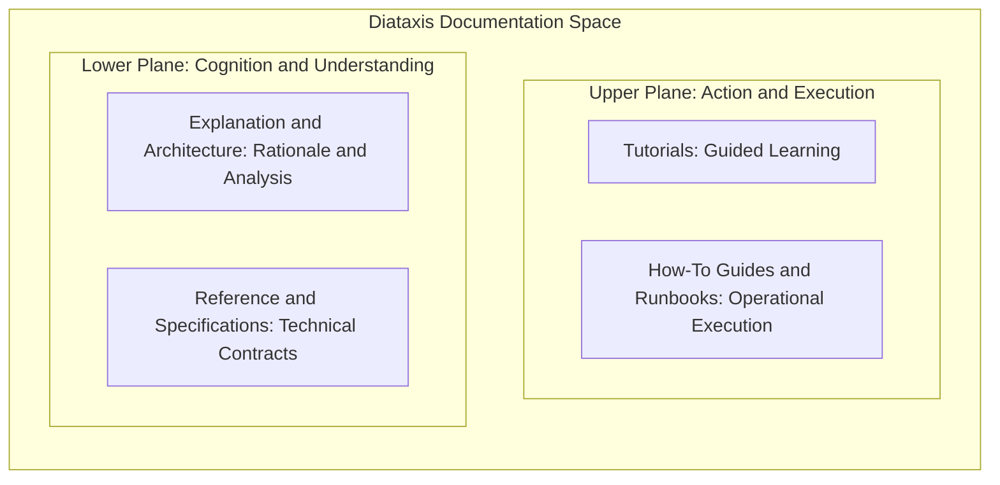
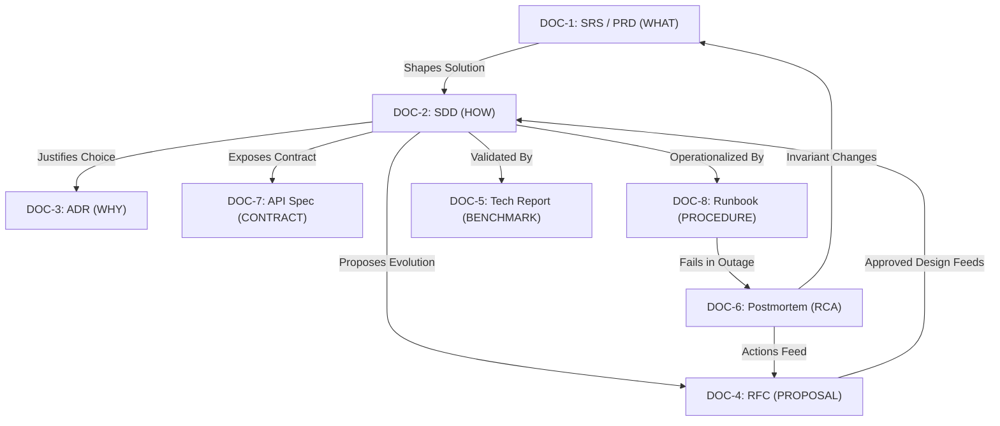

# Document Types Matrix & Diataxis Architectural Blueprint

Defines the classification matrix, information domain boundaries, Diataxis functional structure, POLA identifier registry, and standardized blueprints for 8 industrial engineering document archetypes (`DOC-1` to `DOC-8`), isolating problem, solution, decision, proposal, evaluation, retrospective, data contract, and procedural domains.

## 1. The Diataxis Documentation Framework

### 1.1 The Two Fundamental Axes

1. **Horizontal Axis (Learning vs Practical Work)**: Separates readers acquiring new mental models and comprehension from practitioners executing production tasks, building systems, or resolving outages.
2. **Vertical Axis (Action vs Cognition)**: Separates step-by-step execution sequences from reference specifications or analytical explanations.

The intersection forms four quadrants: Tutorials (Learning x Action), How-to Guides / Runbooks (Practical Work x Action), Reference / Specifications (Practical Work x Cognition), and Explanation / Architecture (Learning x Cognition).



### 1.2 Four Quadrants Comparison Matrix

| Quadrant | Tutorials | How-To Guides / Runbooks | Reference / Specifications | Explanation / Architecture |
| :--- | :--- | :--- | :--- | :--- |
| Coordinate Axes | Learning x Action | Practical Work x Action | Practical Work x Cognition | Learning x Cognition |
| Core Focus | Guided hands-on learning | Solving operational problems | Authoritative technical facts | System context and design rationale |
| Reader State | Needs safe sandbox onboarding | Executing a live task or outage recovery | Writing code or verifying contracts | Evaluating architecture or empirical results |
| Writing Tone | Instructive, supportive | Direct, imperative | Neutral, terse, objective | Analytical, expository |
| Typical Formats | Onboarding walkthroughs | Incident runbooks, recovery SOPs, deployment guides | OpenAPI schemas, SRS requirements, benchmark tables | SDDs, ADRs, RFCs, postmortem RCAs, benchmark reports |
| Acceptance Criterion | 100% reproducible sample output; 0 branching paths | Every step has stdout check; destructive steps have rollback | 100% parameters typed with bounds and error codes | >= 3 trade-off axes and numerical breaking point |

### 1.3 Boundary Isolation Discipline

1. **Zero Reference Dumps in Tutorials**: Keep tutorials an unbroken hands-on flow; link out to Reference tables instead of embedding exhaustive error dictionaries.
2. **Zero Theory Essays in Runbooks**: Engineers under production outage pressure require deterministic commands and checks, not background WAL or protocol lectures.
3. **Zero Walkthroughs in Reference Docs**: Keep API schemas and requirements tables strictly descriptive and indexed.
4. **Confine Architectural Debates to Explanations**: Keep engine trade-offs and rejected alternatives inside SDDs, ADRs, RFCs, and Tech Reports.

## 2. The Eight Core Industrial Technical Document Types

| Archetype | Information Domain | Primary Diataxis Quadrant | Secondary Quadrant (Dedicated Section Only) |
| :---: | :--- | :--- | :--- |
| `DOC-1` (SRS / PRD) | Problem (`WHAT`) | Reference (Rules, FRs, NFRs) | Explanation (Product Context) |
| `DOC-2` (SDD) | Solution (`HOW`) | Explanation (Architecture & Trade-offs) | Reference (Interface & RTM Tables) |
| `DOC-3` (ADR) | Decision (`WHY`) | Explanation (Drivers & Consequences) | N/A |
| `DOC-4` (RFC) | Proposal (`PROPOSAL`) | Explanation (Design Rationale & Alternatives) | Reference (Contract & Migration Delta) |
| `DOC-5` (Tech Report) | Empirical (`EVALUATION`) | Explanation (Saturation Analysis & Recs) | Reference (Harness Spec & Percentile Data) |
| `DOC-6` (Postmortem / RCA) | Retrospective (`POSTMORTEM`) | Explanation (5-Whys & Systemic Factors) | Reference (UTC Timeline & Action Matrix) |
| `DOC-7` (API Spec) | Integration (`CONTRACT`) | Reference (Schemas & Error Codes) | N/A |
| `DOC-8` (Runbook / SOP) | Operational (`PROCEDURE`) | How-to Guide (Commands & Checks) | N/A |

### 2.1 DOC-1: Software Requirements Specification (SRS / PRD, ISO/IEC/IEEE 29148)

- Information Domain: Problem Domain (`WHAT`).
- Primary Audience: Product Managers, Architects, QA Engineers, Stakeholders.
- Diataxis Quadrant: Reference (rules, requirements, NFRs) / Explanation (context & scope boundaries).
- Strict Prohibitions: Zero OOD patterns (Factory, Strategy, Repository, DTO), zero programming-language calls (e.g., `Currency.add()`), zero exception class names, zero physical SQL table schemas or indexes, zero spurious predicate calculus ($\forall, \exists$) on CRUD rules, zero flat IDs (`UC01`, `FR01`), zero `"Manage [Entity]"` CRUD God bundles, and zero phantom diagram nodes.
- Core Sections: Product Context & Boundary, External Actors, Business Rules (`BR-[DOMAIN]-[NN]`), Functional Requirements (`FR-[SUBSYS]-[NN]` or `REQ-[SUBSYS]-[NN]`), Goal-Oriented Use Cases (`UC-[SUBSYS]-[NN]`), Quantitative Non-Functional Requirements (`NFR-[SUBSYS]-[NN]`).

### 2.2 DOC-2: Software Design Description (SDD, IEEE 1016)

- Information Domain: Solution Domain (`HOW`).
- Primary Audience: Software Engineers, Infrastructure Engineers, Architects.
- Diataxis Quadrant: Explanation (topology & trade-offs) / Reference (interface contracts & RTM).
- Strict Prohibitions: Never copy full SRS business narratives; cite upstream UIDs (`BR-xxx`, `FR-xxx`, `REQ-xxx`). Never claim universal scalability without explicit trade-offs and a numerical breaking point.
- Core Sections: Architectural Thesis & Workload Envelope, Container Topology (C4 Tier 1 & Tier 2, <= 9 nodes each), Interface Contracts & Protocols, Persistent Data & Caching Strategy, Requirement Traceability Matrix, System Breaking Point & Saturation Limits.

### 2.3 DOC-3: Architecture Decision Record (ADR, MADR)

- Information Domain: Decision Domain (`WHY`).
- Primary Audience: Architecture Review Boards, Engineering Teams, Maintainers.
- Diataxis Quadrant: Explanation.
- Strict Prohibitions: Never omit >= 2 rejected alternatives with explicit disqualification criteria, >= 3 trade-off axes, negative operational consequences, or the capacity breaking point. Never convert ADRs into step-by-step setup guides.
- Core Sections: Status, Operational Context & Drivers, Considered Options, Multi-Criteria Trade-Off Matrix, Decision Outcome & Disqualification Rationale, Concrete Consequences (Positive/Negative/Neutral), Breaking Point & Re-Evaluation Trigger.

### 2.4 DOC-4: Request for Comments / Engineering Proposal (RFC)

- Information Domain: Proposal & Consensus Domain (`PROPOSAL`).
- Primary Audience: Tech Leads, Cross-Functional Teams, Security & Ops.
- Diataxis Quadrant: Explanation (motivation & rationale) / Reference (proposed contract delta).
- Strict Prohibitions: Require >= 2 rejected alternatives with disqualification rationale, explicit backward-compatibility and rollback/migration plan, and candid unresolved open questions.
- Core Sections: Summary & Motivation, Proposed Design & Contracts, Multi-Phase Rollout Plan, Compatibility & Deprecation Strategy, Security & Operational Resilience, Rejected Alternatives, Open Questions.

### 2.5 DOC-5: Technical Report & Benchmark Evaluation (ISO/IEC/IEEE 15289)

- Information Domain: Empirical Evaluation Domain (`EVALUATION`).
- Primary Audience: Performance Engineers, Architects, Technical Leadership.
- Diataxis Quadrant: Explanation (analysis & recommendations) / Reference (harness config & percentile tables).
- Strict Prohibitions: Never omit hardware/OS/network/harness specs; never report sole means without `P50`/`P95`/`P99` percentiles and variance; never assert subjective superiority without direct tabular data; never fabricate unmeasured benchmark metrics.
- Core Sections: Objectives & Findings Summary, Test Environment & Harness Spec, Workload Methodology, Percentile Results & Saturation Profiling, Breaking Point Analysis & Recommendations.

### 2.6 DOC-6: Incident Postmortem & Root Cause Analysis (RCA)

- Information Domain: Investigative & Remediation Domain (`POSTMORTEM`).
- Primary Audience: Engineering Leadership, SREs, Product Stakeholders.
- Diataxis Quadrant: Explanation (5-Whys & systemic factors) / Reference (UTC timeline & action matrix).
- Strict Prohibitions: Zero personal blame ("operator error", "human mistake"); never omit exact UTC chronology; never leave remediation actions without owner, priority, target date, and ticket UID.
- Core Sections: Incident Metadata, User/SLA Impact, UTC Chronological Timeline, 5-Whys Root Cause & Fault Tree, Systemic Contributing Factors, Went Well / Went Poorly / Luck, Corrective Action Matrix (`ACT-[DOMAIN]-[NN]`).

### 2.7 DOC-7: Interface and Data Contract Specifications (API Spec, OpenAPI 3.1)

- Information Domain: Integration Domain (`CONTRACT`).
- Primary Audience: API Consumers, Backend/Frontend Engineers, Integrators.
- Diataxis Quadrant: Reference.
- Strict Prohibitions: Zero untyped payloads (every field requires type, nullability, and bounds), zero ad-hoc error shapes (require RFC 7807 Problem Details or gRPC status codes), zero undocumented status codes, zero tutorial prose.
- Core Sections: Endpoint Transport & Auth Scopes, Request Parameters & Body Schema, Response Schema & Error Status Matrix, Concrete Success & RFC 7807 Failure Payloads.

### 2.8 DOC-8: Operational Runbooks & Standard Operating Procedures (SOP)

- Information Domain: Operational Domain (`PROCEDURE`).
- Primary Audience: On-Call Engineers, SREs, Systems Administrators.
- Diataxis Quadrant: How-to Guide.
- Strict Prohibitions: Never list an executable command without an immediate stdout/stderr verification check; never include destructive actions (`rm`, `drop`, failover, truncate) without an explicit rollback routine; never embed theoretical tutorials or architecture essays.
- Core Sections: Alert Symptoms & Trigger Thresholds, Prerequisites & Tooling, Numbered Execution Steps (Command + Expected Verification Output + Rollback for destructive steps), Escalation Roster.

### 2.9 Canonical POLA Prefix Registry

Every traceable section heading MUST follow `### X.Y [PREFIX]-[DOMAIN]-[NN]: [Title]` (with top-level document IDs `ADR-[NNNN]` / `RFC-[NNNN]` permitted on `# H1` titles). Flat 2-part IDs (`UC01`, `FR01`) are forbidden.

| Archetype | Approved Section Heading Prefixes (`[PREFIX]-[DOMAIN]-[NN]`) | Document-Level H1 ID |
| :--- | :--- | :--- |
| `DOC-1` (SRS / PRD) | `BG-[DOMAIN]-[NN]`, `BR-[DOMAIN]-[NN]`, `FR-[SUBSYS]-[NN]`, `REQ-[SUBSYS]-[NN]`, `UC-[SUBSYS]-[NN]`, `NFR-[SUBSYS]-[NN]` | Optional |
| `DOC-2` (SDD) | `THS-[DOMAIN]-[NN]`, `TOP-[DOMAIN]-[NN]`, `CMP-[SUBSYS]-[NN]`, `DAT-[DOMAIN]-[NN]`, `BRK-[DOMAIN]-[NN]` | Optional |
| `DOC-3` (ADR) | `THS-[DOMAIN]-[NN]`, `DRV-[DOMAIN]-[NN]`, `TOP-[DOMAIN]-[NN]`, `DEC-[DOMAIN]-[NN]`, `ALT-[DOMAIN]-[NN]`, `CON-[DOMAIN]-[NN]`, `BRK-[DOMAIN]-[NN]` | `ADR-[NNNN]` |
| `DOC-4` (RFC) | `THS-[DOMAIN]-[NN]`, `PROP-[DOMAIN]-[NN]`, `ROL-[DOMAIN]-[NN]`, `ALT-[DOMAIN]-[NN]`, `BRK-[DOMAIN]-[NN]` | `RFC-[NNNN]` |
| `DOC-5` (Tech Report) | `HYP-[TOPIC]-[NN]`, `ENV-[TOPIC]-[NN]`, `FIND-[TOPIC]-[NN]`, `BRK-[TOPIC]-[NN]`, `REC-[TOPIC]-[NN]` | Optional |
| `DOC-6` (Postmortem) | `INC-[YYYYMM]-[NN]`, `RCA-[TOPIC]-[NN]`, `ACT-[DOMAIN]-[NN]` | Optional |
| `DOC-7` (API Spec) | `API-[SUBSYS]-[NN]`, `ERR-[SUBSYS]-[NN]` | Optional |
| `DOC-8` (Runbook / SOP) | `SOP-[SUBSYS]-[NN]` | Optional |

## 3. Structural Blueprints (`DOC-1` to `DOC-8` & Cross-Cutting Templates)

### 3.1 DOC-1: Software Requirements Specification (SRS / PRD) Blueprint

```markdown
# Software Requirements Specification: [System Name]

## 1. Product Context & System Boundary
### 1.1 BG-[DOMAIN]-01: Purpose & Business Objectives
### 1.2 Scope & Out-of-Scope Boundaries
### 1.3 External Actors & User Personas

## 2. Business Rules & Invariants
### 2.1 BR-[DOMAIN]-01: [Rule Name]

## 3. Functional Requirements
### 3.1 FR-[SUBSYS]-01: [Requirement Name]

## 4. Goal-Oriented Use Case Specifications
### 4.1 UC-[SUBSYS]-01: [Active Verb + Direct Object]
- Actor:
- Preconditions:
- Trigger:
- Main Success Flow:
  1. Actor submits...
  2. System validates...
  3. System records...
- Alternative / Exception Flows:
  - 2a. [Business validation failure]: System rejects request with business error code.
- Postconditions:

## 5. Non-Functional Quantitative Requirements
### 5.1 NFR-PERF-01: [Metric with Threshold and Load Envelope]
### 5.2 NFR-REL-01: [Availability / Consistency Invariant]
```

### 3.2 DOC-2: Software Design Description (SDD) Blueprint

```markdown
# Software Design Description: [System Name]

## 1. Architectural Thesis & Workload Envelope
### 1.1 THS-[DOMAIN]-01: Problem Statement & Technical Thesis
### 1.2 Accepted Constraints & Multi-Criteria Trade-Offs (>= 3 Axes)

## 2. System Topology (Two-Tier C4 <= 9 Nodes Each)
### 2.1 TOP-[DOMAIN]-01: System Context Overview (Tier 1)
### 2.2 TOP-[DOMAIN]-02: Container Decomposition (Tier 2)

## 3. Component Design & Interface Contracts
### 3.1 CMP-[SUBSYS]-01: [Component Name]
- Upstream Links: `FR-...`, `BR-...`

## 4. Persistent Storage & Caching Strategy
### 4.1 DAT-[DOMAIN]-01: Data Partitioning & Consistency Invariants

## 5. Requirement Traceability Matrix (RTM)

## 6. System Breaking Point & Capacity Saturation Limits
### 6.1 BRK-[DOMAIN]-01: Maximum Sustainable Envelope & Degradation Thresholds
```

### 3.3 DOC-3: Architecture Decision Record (ADR) Blueprint

```markdown
# ADR-[NNNN]: [Short Decision Title]

## 1. Status & Metadata
- Status: [Proposed | Accepted | Deprecated | Superseded by ADR-XXXX]
- Scope: [Target Subsystem / Pipeline]

## 2. Context, Workload & Decision Drivers
### 2.1 THS-[DOMAIN]-01: Technical Thesis & Problem Constraints
### 2.2 DRV-[DOMAIN]-01: Quantified Decision Drivers

## 3. Considered Options & Multi-Criteria Trade-Off Matrix
| Criterion | Option A | Option B | Option C |
| :--- | :--- | :--- | :--- |
| P99 Latency at Target Load | ... | ... | ... |
| Consistency / Replay Guarantee | ... | ... | ... |
| Operational Complexity & Cost | ... | ... | ... |

## 4. Decision Outcome & Disqualification Rationale
### 4.1 DEC-[DOMAIN]-01: Selected Architecture
### 4.2 ALT-[DOMAIN]-01: Rejected Alternatives & Disqualification Criteria (>= 2 Options)

## 5. Consequences, Breaking Point & Re-Evaluation Triggers
### 5.1 CON-[DOMAIN]-01: Positive, Negative & Neutral Realities
### 5.2 BRK-[DOMAIN]-01: Quantitative Breaking Point (Scale Threshold Requiring Re-Architecture)
```

### 3.4 DOC-4: Request for Comments (RFC) Blueprint

```markdown
# RFC-[NNNN]: [Proposed Technical Feature or Architectural Evolution]

## 1. Summary, Thesis & Motivation
### 1.1 THS-[DOMAIN]-01: Technical Thesis & Workload Envelope
### 1.2 Current Bottlenecks & Pain Points

## 2. Proposed Design & Contracts
### 2.1 PROP-[DOMAIN]-01: Topology Impact (<= 9 Nodes per Diagram + Contract Table)
### 2.2 PROP-[DOMAIN]-02: Protocol & Schema Changes

## 3. Phased Rollout, Compatibility & Rollback Plan
### 3.1 ROL-[DOMAIN]-01: Phase 1 Dark Launch / Canary
### 3.2 ROL-[DOMAIN]-02: Phase 2 Full Migration & Deprecation Window

## 4. Security, Resilience & Trade-Off Analysis
### 4.1 Security Threats & Trade-Off Matrix (>= 3 Axes)
### 4.2 BRK-[DOMAIN]-01: Quantitative Breaking Point & Saturation Threshold

## 5. Rejected Alternatives & Open Questions
### 5.1 ALT-[DOMAIN]-01: Disqualified Options (>= 2 Options)
### 5.2 Unresolved Review Questions
```

### 3.5 DOC-5: Technical Report & Benchmark Evaluation Blueprint

```markdown
# Technical Report: [System Performance & Benchmark Evaluation]

## 1. Executive Thesis & Findings Summary
### 1.1 HYP-[TOPIC]-01: Evaluation Hypothesis & Workload Envelope
### 1.2 FIND-[TOPIC]-01: Key Quantitative Findings

## 2. Reproducible Test Environment & Methodology
### 2.1 ENV-[TOPIC]-01: Hardware, Kernel & Network Topology
### 2.2 ENV-[TOPIC]-02: Software Versions & Harness Configuration
### 2.3 Workload Methodology & Synthetic Traffic Profile

## 3. Quantitative Results & Percentile Distributions
### 3.1 Throughput vs Latency (`P50`, `P95`, `P99`, Error Rate)
### 3.2 BRK-[TOPIC]-01: Resource Saturation & Breaking Point

## 4. Engineering Recommendations
### 4.1 REC-[TOPIC]-01: [Actionable Recommendation Title]
```

### 3.6 DOC-6: Incident Postmortem / Root Cause Analysis Blueprint

```markdown
# Incident Postmortem: [YYYY-MM-DD] - [Incident Summary]

## 1. Incident Overview & Metadata
### 1.1 INC-[YYYYMM]-01: Severity, Window & SLA Impact
- Severity: [SEV-1 | SEV-2]
- Window: [YYYY-MM-DD HH:MM UTC to HH:MM UTC]
- Quantified User Impact: [Rejected requests / Error rate / SLA breach]

## 2. Chronological Incident Timeline (UTC)

## 3. Root Cause Analysis
### 3.1 RCA-[TOPIC]-01: 5-Whys Causal Chain & Fault Propagation Diagram

## 4. Systemic Factors: Went Well, Went Poorly & Luck

## 5. Preventative & Corrective Action Matrix
| UID | Action | Type | Priority | Owner | Target Date | Ticket |
| :--- | :--- | :--- | :---: | :--- | :---: | :--- |
| `ACT-RES-01` | Configure 2s timeout + circuit breaker | Prevent | P0 | NetSec | YYYY-MM-DD | SEC-402 |
```

### 3.7 DOC-7: API Specification & Data Contract Blueprint

```markdown
# API Contract: [Service / Resource Name] (`vX`)

## 1. Endpoint Overview & Authorization
### 1.1 API-[SUBSYS]-01: [HTTP Method + Resource URI]
- Transport & Protocol: [REST JSON HTTP/2 | gRPC]
- Auth & Required Scopes: [OAuth 2.0 Bearer / mTLS + Scope]
- Idempotency & Rate Limit: [Header + RPS Quota]

## 2. Request Contract
| Parameter | Location | Type | Nullable | Required | Constraints | Default |
| :--- | :---: | :--- | :---: | :---: | :--- | :--- |
| `idempotency_key` | Header | `UUIDv4` | No | Yes | Unique per 24h | None |
| `amount` | Body | `Decimal String` | No | Yes | `> 0.00`, scale 2 | None |

## 3. Response Schema & Error Matrix (RFC 7807)
| Field / Status | Type / URI | Nullable / Action | Constraints / Trigger Condition |
| :--- | :--- | :---: | :--- |
| `resource_id` | `UUIDv4` | No | Returned on `201 Created` |
| `422` | `/errors/insufficient-funds` | Retry disabled | Available balance `< amount` |

## 4. Concrete Payload Examples
```

### 3.8 DOC-8: Operational Runbook / SOP Blueprint

````markdown
# Runbook: [Operational Procedure or Recovery Title]

## 1. Alert Triggers & Prerequisites
### 1.1 SOP-[SUBSYS]-01: Symptoms & Firing Thresholds
- Alert Name: `[AlertIdentifier]`
- Trigger Threshold: [Numeric SLO breach, e.g., Primary unreachable >= 30s]
### 1.2 Environment Prerequisites & Privileges
- Required Access: [SSH / Bastion / DB superuser role]
- Required CLI Tools: [`pg_ctl`, `systemctl`, `psql`]

## 2. Execution Sequence (Verify Every Step)
### 2.1 Step 1: [Imperative Action]
1. Command:
   ```bash
   sudo systemctl stop postgresql
   ```
2. Verification Check (Expected Output):
   ```bash
   systemctl is-active postgresql
   # Expected stdout: inactive (exit code 3)
   ```
3. Rollback Routine (Required for Destructive / State-Changing Steps):
   ```bash
   sudo systemctl start postgresql
   ```

## 3. Escalation Roster & Communication
| Escalation Tier | Role / Channel | Trigger Condition | SLA |
| :---: | :--- | :--- | :---: |
| Tier 1 | Primary On-Call SRE | Initial alert page | <= 5m |
| Tier 2 | Database Engineering Lead | Verification fails after Step 2 | <= 15m |
````

### 3.9 Requirement Traceability Matrix (RTM) Template

| Goal ID | Business Rule | Functional Requirement | Use Case ID | Component Module | Automated Test Case | Status |
| :--- | :--- | :--- | :--- | :--- | :--- | :---: |
| `BG-ORD-01` | `BR-FIN-01` | `FR-ORD-01` | `UC-ORD-01` | `PaymentGatewayProxy` | `test_idempotent_order_settlement` | PASS |
| `BG-ORD-01` | `BR-FIN-02` | `FR-ORD-02` | `UC-ORD-02` | `LedgerPersistenceService` | `test_ledger_daily_balance_invariant` | PASS |
| `BG-AUTH-01` | `BR-AUTH-01` | `FR-AUTH-01` | `UC-AUTH-01` | `SecurityTokenValidator` | `test_fido2_signature_verification` | PASS |

### 3.10 Multi-Criteria Trade-Off Matrix Template

| Design Dimension | Evaluated Option A | Evaluated Option B | Selected | Primary Trade-Off Justification |
| :--- | :--- | :--- | :---: | :--- |
| State Storage | Redis Cluster | PostgreSQL | Option A | Trades volatile crash-recovery overhead for P99 `< 5 ms` reads. |
| Ingestion | Long Polling | Push Webhooks | Option B | Cuts idle polling traffic at the cost of tenant health tracking. |
| Consistency | Sync Replication | Async Replication | Option B | Preserves AZ availability during partitions, trading read freshness. |

## 4. Lifecycle Graph & Cross-Referencing Discipline



1. **Zero Redundant Copying**: SDDs, API specs, and RFCs cite upstream requirement UIDs (`BR-FIN-01`, `FR-WAL-02`) rather than duplicating SRS narratives.
2. **Backward Traceability**: Every component, endpoint, and RFC change cites an upstream goal or requirement UID; artifacts lacking upstream justification are rejected as scope bloat.
3. **Closed-Loop Remediation**: Every Postmortem action item (`ACT-xxx`) tracks to an update in `DOC-1`, `DOC-2`, or `DOC-8`.
4. **Document Self-Containment**: Keep the document self-contained within its abstraction layer without deflecting responsibility in body text (`refer to Document X for schema`); isolate requested citations inside `## References`.
5. **Evolution Blast Radius & Value Preservation**: Trace cascading impacts across the lifecycle graph before modifying an existing document; preserve verified quantitative thresholds and align breaking trade-offs with stakeholders before rewriting.
