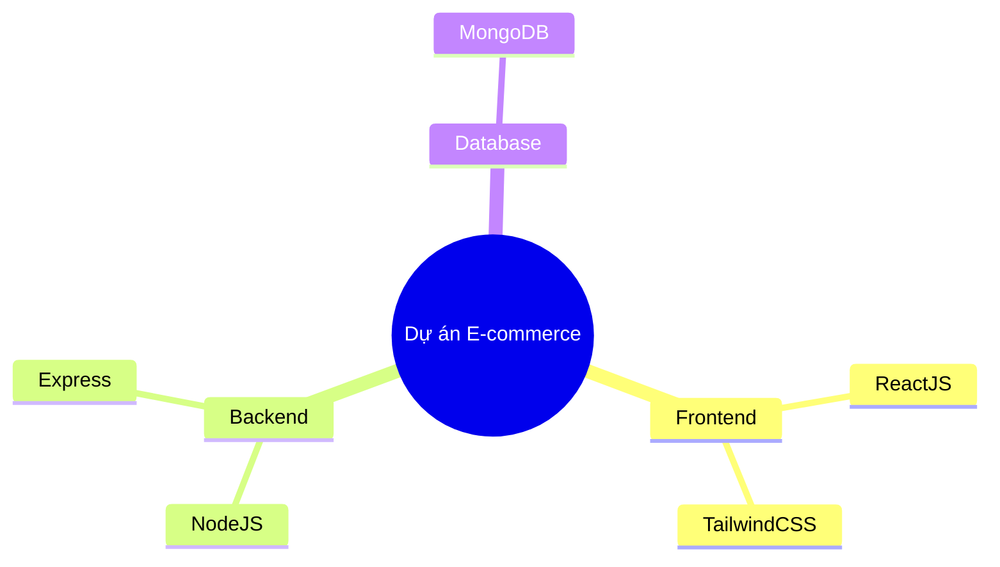
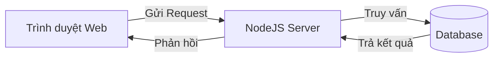
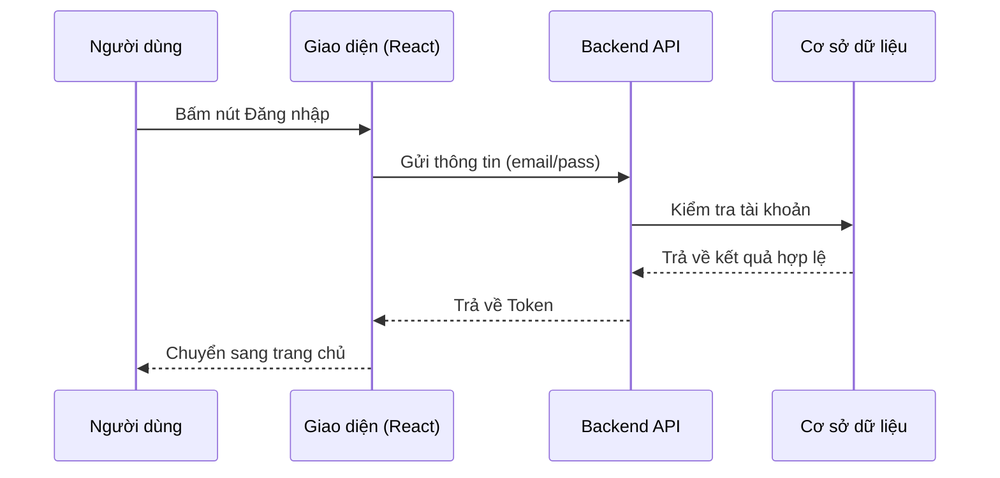

# Diagram Guide for Interns

## Markdown Mermaid Guidelines
Mermaid diagrams are a fantastic way to explain concepts to interns, provided they are kept simple.

### General Rules
- Always use standard `mermaid` code blocks.
- **Keep it Simple**: No more than 10 nodes per diagram. If it gets larger, abstract it or break it down.
- **Language**: Use the user's language for node labels (e.g., Vietnamese).
- **Direction**: Use Top-Down (`TD`) or Left-Right (`LR`) depending on what's easiest to read. Flowcharts usually look good Left-Right.

### 1. Mindmaps (For Tech Stack or Directory Structure)
Use mindmaps to show how things are related hierarchically.

### 2. Flowcharts (For Logic and Architecture)
Use flowcharts to show connections.

### 3. Sequence Diagrams (For Deep Flow Tracing)
Use sequence diagrams when tracing a step-by-step request. Keep participants to a maximum of 4.

